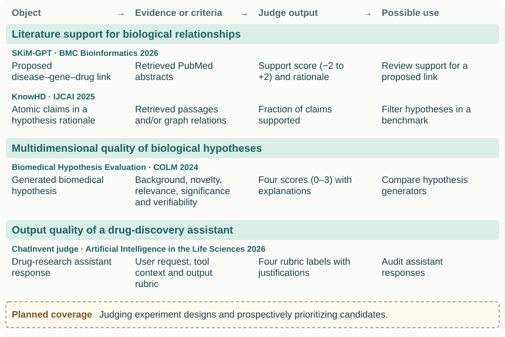
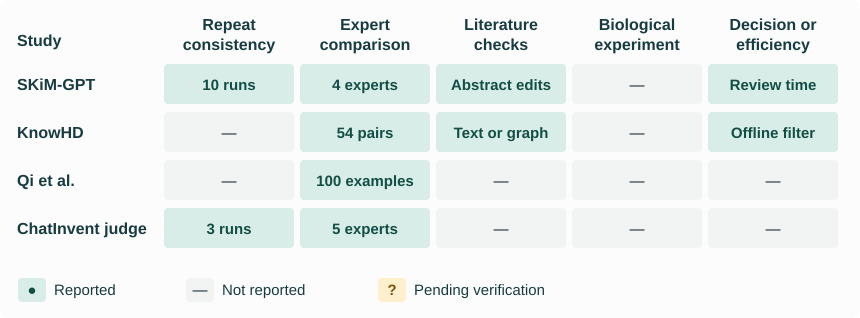

# LLM-as-a-Judge for Biological Scientific Discovery

*Tasks, Methods, and Validation*

What do LLM judges evaluate in biological discovery, how do they judge, and what evidence supports their judgments? A score can describe how well papers support a proposed relationship, how promising a hypothesis sounds to a reviewer, or how well an assistant answered a research question. Each interpretation calls for a different test.

[Framework](#research-framework) · [Tasks and methods](#tasks-and-methods) · [Original papers](#reading-guide) · [Evidence map](#validation-evidence) · [Further reading](#further-reading) · [Scope and contributions](#scope-and-contributions)

## Research framework

**Figure 1.** The diagram shows where a judge enters a research workflow. Solid boxes illustrate tasks represented in the reading set. The dashed box identifies a prospective test whose outcome would connect a judgment to an independently measured discovery.

## Tasks and methods

### Evidence-grounded claim and hypothesis assessment

Does the supplied evidence support the proposed relationship? SKiM-GPT reads abstracts and scores the relationship as a whole. KnowHD splits the hypothesis and rationale into claims so that unsupported premises affect the aggregate score. Valsci offers an [adjacent scientific claim-verification workflow](docs/evidence.md#valsci).

### Multidimensional evaluation of biological hypotheses

A hypothesis can be relevant to a problem yet difficult to test. Qi et al. give GPT-4 the scientific background and four criteria so researchers can compare generators on qualities that a single support score would obscure.

### Evaluation of biological research outputs

A drug-discovery assistant can return a clear answer that omits part of a request. The ChatInvent judge grades the delivered response against the request and task context. Tool-call correctness has its own programmatic check.

<!-- COMPARISON:START -->

| Paper | Object | Method | Validation basis | Use | Main limit |
|---|---|---|---|---|---|
| [SKiM-GPT](https://link.springer.com/article/10.1186/s12859-025-06350-7) | Disease–gene–drug link | Signed support score | Same abstracts, four experts | Review a proposed link | Abstract coverage |
| [KnowHD](https://ijcai.org/proceedings/2025/0873.pdf) | Claims in a rationale | Atomic entailment | Earlier evidence, expert choices | Filter hypotheses | Retrieval misses |
| [Qi et al.](https://arxiv.org/pdf/2407.08940) | Generated hypothesis | Four rubric scores | Expert rubric scores | Compare generators | Selected settings |
| [ChatInvent judge](https://research.chalmers.se/publication/554919/file/554919_Fulltext.pdf) | Assistant response | Four rubric labels | Repeats, expert majority | Audit assistant outputs | One assistant |

<!-- COMPARISON:END -->

## Reading guide

Start with the primary paper whose unit of judgment matches your question. **A** marks a study that designs or validates a judge. **B** marks a biological study that uses one.

<!-- PRIMARY:START -->

### SKiM-GPT

*SKiM-GPT: combining biomedical literature-based discovery with large language model hypothesis evaluation* · BMC Bioinformatics 27, 16 (online 17 December 2025) · **A**

**Judgment.** The judge evaluates a proposed disease–gene–drug relationship. It reads PubMed titles and abstracts linking the terms, optionally filtered for relevance. It returns a support score from −2 to +2 and explains its rating.

**Validation.** Four computational biologists scored the same evidence. Without filtering, median directions agreed for 13 of 14 hypotheses.

**Limit.** The selected hypotheses cover 14 relationships. Abstract coverage and publication bias restrict the evidence.

[Paper](https://link.springer.com/article/10.1186/s12859-025-06350-7) · [Code](https://github.com/stewart-lab/skimgpt) · [Evidence notes](docs/evidence.md#skim-gpt)

### KnowHD

*Toward Reliable Scientific Hypothesis Generation: Evaluating Truthfulness and Hallucination in Large Language Models* · IJCAI 2025, 7849–7857 · **A**

**Judgment.** The judge evaluates atomic claims extracted from a hypothesis and its reasoning. It receives retrieved PubMed passages, knowledge-graph relations, or both. Each claim receives a binary support decision. Equation 3 averages these decisions across claims.

**Validation.** Two experts compared 54 selected pairs. Expert–expert agreement was 80%. Experts selected the more grounded hypothesis as more likely true in 59.26% of pairs.

**Limit.** Retrieval misses count against groundedness. Selection for a large score gap limits extrapolation to close pairs. The score does not measure novelty or biological truth.

[Paper](https://ijcai.org/proceedings/2025/0873.pdf) · [Code](https://github.com/gzxiong/TruthHypo) · [Evidence notes](docs/evidence.md#knowhd)

### Qi et al.

*Large Language Models as Biomedical Hypothesis Generators: A Comprehensive Evaluation* · COLM 2024 · **B**

**Judgment.** GPT-4 evaluates a generated biomedical hypothesis. It receives the scientific background and criteria for novelty, relevance, significance and verifiability. It assigns each dimension a score from 0 to 3 and explains the score.

**Validation.** Three biomedical experts rated 100 unseen examples. Across the selected settings in Table 1, Spearman correlations of model and human average ratings range from 0.73 to 0.94.

**Limit.** Human review concentrated on selected high-performing settings. Perceived novelty and verifiability are rubric judgments.

[Paper](https://arxiv.org/pdf/2407.08940) · [Code](https://github.com/TsinghuaC3I/LLM4BioHypoGen) · [Evidence notes](docs/evidence.md#qi-biomedical)

### ChatInvent judge

*Designing an LLM-based evaluation system for agentic AI in drug discovery through human alignment* · Artificial Intelligence in the Life Sciences 10, 100187 · **A**

**Judgment.** The judge grades ChatInvent’s answer to a drug-discovery request. It sees the request, response, evaluation context and expected, accepted and actual tool calls. It assigns a rubric label and justification for completeness, relevancy, structural clarity and scope adherence. A separate program checks tool-call correctness.

**Validation.** Five experts provided the reference ratings. After few-shot optimization, exact agreement with the human majority rose from 0.80 to 0.86 on ten validation questions.

**Limit.** One assistant. Agreement varies by dimension. Prompt optimization was evaluated on ten validation questions. Scores concern the answer delivered to the user.

[Paper](https://research.chalmers.se/publication/554919/file/554919_Fulltext.pdf) · [Code](https://github.com/MolecularAI/langdmta-lab/blob/main/evaluation/langdmta_eval/README.md) · [Evidence notes](docs/evidence.md#chatinvent-judge)

<!-- PRIMARY:END -->

## Validation evidence

**Figure 2.** Each column asks a separate question. A filled cell identifies the reported test. A dash means the study gives no result for that endpoint. The last column distinguishes time spent reviewing evidence from retrospective filtering. Detailed settings for each cell are in the [evidence notes](docs/evidence.md).

### What the results support

- **What does a high score mean?** SKiM-GPT can give strong support to a relationship already documented in abstracts. In KnowHD, one unsupported premise lowers the fraction of supported claims. Neither score estimates the probability that a new experiment will succeed. [SKiM-GPT, Fig. 3](https://link.springer.com/article/10.1186/s12859-025-06350-7) · [KnowHD, Eq. 3](https://ijcai.org/proceedings/2025/0873.pdf)
- **What did the experts judge?** Qi et al. asked experts to score properties of hypotheses. ChatInvent’s experts graded responses to requests. Agreement supports the use of each rubric on the examples studied. The studies leave open whether a highly rated hypothesis is biologically correct or a highly rated response leads to a better compound. [Qi et al., §3.4](https://arxiv.org/pdf/2407.08940) · [ChatInvent, §§5.2–5.4](https://research.chalmers.se/publication/554919/file/554919_Fulltext.pdf)
- **What changed downstream?** For the same 159 abstracts, SKiM-GPT reported 0.23 hours of system time against 8.42 hours per human reviewer. KnowHD used groundedness to filter candidates retrospectively. Neither design measured discovery yield in a prospective comparison of judge-assisted and unassisted decisions. [SKiM-GPT, Table 1](https://link.springer.com/article/10.1186/s12859-025-06350-7) · [KnowHD, Table 4](https://ijcai.org/proceedings/2025/0873.pdf)

### Coverage gaps

Which experiments merit running, and which candidates should receive a limited assay budget? The core set has no study directly validating an LLM judge for experimental-design quality or prospective candidate prioritization. A useful next inclusion would identify the proposed design or candidate set, the constraints given to the judge, its recorded verdict, and an independent comparison with expert choices or measured outcomes.

## Further reading

<!-- PAPER-LIST:START -->

General methods and reliability · C (8)

- [G-Eval: NLG Evaluation using GPT-4 with Better Human Alignment](https://doi.org/10.18653/v1/2023.emnlp-main.153) — Operationalizes a written evaluation criterion as model-generated evaluation steps and a score. [Notes](docs/evidence.md#g-eval)
- [FActScore: Fine-grained Atomic Evaluation of Factual Precision in Long Form Text Generation](https://doi.org/10.18653/v1/2023.emnlp-main.741) — Decomposes long answers and estimates the fraction of facts supported by a reference source. [Notes](docs/evidence.md#factscore)
- [Judging LLM-as-a-Judge with MT-Bench and Chatbot Arena](https://arxiv.org/abs/2306.05685) — Introduces MT-Bench and documents position, verbosity, and self-enhancement biases in LLM judges. [Notes](docs/evidence.md#mt-bench)
- [Length-Controlled AlpacaEval: A Simple Way to Debias Automatic Evaluators](https://arxiv.org/abs/2404.04475) — Regresses out answer length to produce a length-controlled win rate, reducing verbosity bias. [Notes](docs/evidence.md#length-controlled-alpacaeval)
- [Investigating Non-Transitivity in LLM-as-a-Judge](https://arxiv.org/abs/2502.14074) — Shows pairwise LLM judgments violate transitivity; analyzes Bradley-Terry limits and round-robin tournament aggregation. [Notes](docs/evidence.md#non-transitivity)
- [Large Language Models are not Fair Evaluators](https://doi.org/10.18653/v1/2024.acl-long.511) — Swapping the order of two answers changes the reported winner. The authors test balanced presentation orders to reduce this effect. [Notes](docs/evidence.md#fair-evaluators)
- [LLM Evaluators Recognize and Favor Their Own Generations](https://arxiv.org/abs/2404.13076) — Tests whether judges recognize their own text and finds that stronger self-recognition tracks a stronger preference for their own answers. [Notes](docs/evidence.md#self-preference)
- [All Verdicts are Not Equal: Rethinking LLM Judge Reliability](https://doi.org/10.18653/2026.aacl-long.207) — Crosses repeated trials with answer-order swaps and reference labels to distinguish reproducibility, order sensitivity, and correctness. [Notes](docs/evidence.md#verdict-reliability)

**Workflows and adjacent cases · D (1)**

- [Valsci: an open-source, self-hostable literature review utility for automated large-batch scientific claim verification using large language models](https://doi.org/10.1186/s12859-025-06159-4) — Uses retrieved sources to produce a claim-level evidence report. [Notes](docs/evidence.md#valsci)

**Related reviews · E (1)**

- [A survey on LLM-as-a-judge](https://doi.org/10.1016/j.xinn.2025.101253) — Maps the LLM-as-a-Judge landscape, including a consistency/reliability cluster covering biases and stability. [Notes](docs/evidence.md#judge-survey)

<!-- PAPER-LIST:END -->

## Scope and contributions

This collection covers basic biology, biological engineering and drug discovery. Clinical diagnosis and patient advice are adjacent areas. Inclusion requires a locatable **object, criterion or evidence input, judgment output, and method section, appendix or public prompt**. A generator, specialist predictor, human-only evaluation or system-level experimental result alone cannot establish direct use of an LLM judge.

Edit [papers.yaml](papers.yaml), using one stable ID for all versions of a paper. Record the five validation endpoints separately. For core papers, supply the short comparison fields under `homepage`; each reported endpoint has a short map label and a detailed note. Use `Not reported` and `Pending verification` for the other states. Keep records awaiting verification in the [screening log](docs/screening.md).

With Python 3.9+ and PyYAML installed, run `python3 generate_paper_list.py` and then `python3 generate_paper_list.py --check`. The script refreshes marked blocks and the evidence map. The surrounding analysis and the [editable framework diagram](assets/framework.svg) are maintained by hand.

[Full evidence notes](docs/evidence.md) · [Screening decisions and historical snapshots](docs/screening.md)
